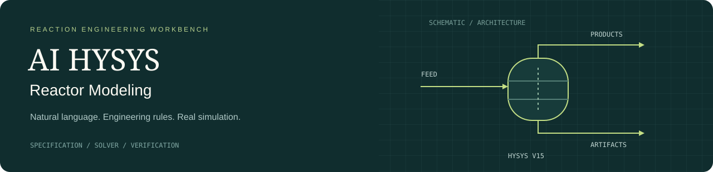
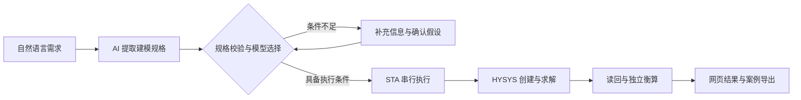

<p align="center">
  
</p>

# AI HYSYS Reactor Modeling

**面向反应工程的自然语言建模工作台。** 将工艺需求转换为可审查的规格，在 Aspen HYSYS V15 中创建、求解并保存案例，返回可核验的物流与结果文件。

[](https://github.com/Huhy666/ai-hysys-reactor-modeling/actions/workflows/quality.yml)


[快速开始](docs/getting-started.md) · [架构设计](docs/architecture.md) · [网页演示](docs/web-demo.md) · [验证记录](docs/validation.md) · [技术报告 PDF](docs/report.pdf)

## 从需求到可交付案例

语言理解、工程判断与数值计算分别承担明确职责：AI 提取输入，规则校验适用性，HYSYS 执行模拟。缺失条件及未确认假设会阻断执行；结果保留来源、任务编号和案例文件，便于复核。



| 工程环节 | 实现内容 |
|---|---|
| 需求理解 | 组分映射、反应计量、温压与流量、转化率、多工况、显式假设 |
| 模型判断 | 确定性选择规则、选择理由、信息不足时的阻断与澄清 |
| 实机执行 | 基础案例副本、COM 自动化、专用 STA 工作线程、串行任务队列 |
| 结果核验 | 变量可用性、数值稳定、目标转化率、质量及元素守恒 |
| 结果交付 | 运行历史、结构化 JSON、物流 CSV、原生 HYSYS 案例 |

## 实机验证范围

截至 **2026-10-26**，远程工作站验收记录显示以下自然语言输入均完成求解及 JSON / CSV / HYSYS 文件下载。

| 反应体系 | 模型 | 验证工况 |
|---|---|---|
| 甲苯歧化 | Conversion | 10000 kg/h，380℃，2.5 MPa，甲苯转化率 50% |
| 甲烷蒸汽重整 | Equilibrium | CH₄:H₂O = 1:2.7，13.5 bar，出口 600℃ / 710℃ |
| 水煤气变换 | Conversion | CO 基准转化率 30% |
| 逆水煤气变换 | Conversion | CO₂ 基准转化率 20% |
| 二氧化碳甲烷化 | Conversion | CO₂ 基准转化率 10% |

本地 **234 项非 HYSYS 测试通过**。实机验收、软件测试及浏览器夹具回归分别记录，互不替代。详细条件、证据位置和验证限制见[验证记录](docs/validation.md)。

**支持边界：** Conversion 与 Equilibrium 已有真实执行路径；Gibbs、CSTR、PFR 目前仅有选择规则。给定转化率的案例用于计算该指标下的出口分布，不代表预测动力学或证明该转化率的热力学可达性。

## 在 HYSYS 工作站上运行

需要 Windows、64 位 Python 3.11 或 3.12、Aspen HYSYS V15、有效许可证，以及可用的语言模型接口。

```powershell
# 在项目根目录安装依赖；已有 .env 会保留
powershell -ExecutionPolicy Bypass -File scripts\setup_remote.ps1

# 完成 .env 配置和基础案例准备后启动
.\.venv\Scripts\python.exe scripts\run_server.py
```

在**同一工作站**的浏览器访问 **http://127.0.0.1:8000**。也可双击 `start_web.cmd` 启动并打开页面。没有 HYSYS 的电脑可阅读代码、运行非 HYSYS 测试和查看网页外壳，无法执行真实模拟。

配置分为两部分：

- **语言模型：** `LLM_BASE_URL`、`LLM_MODEL`、`LLM_API_KEY`。
- **模拟环境：** `HYSYS_BASE_CASE_PATH`、`HYSYS_PROBE_RESULT_PATH`、`HYSYS_ARTIFACT_DIR`。

详见[安装与配置](docs/getting-started.md)。`.env.example` 仅为模板；实际 `.env` 不进入仓库。

## 网页如何展示

1. 填写完整需求，或点击预置输入示例。
2. 展示规格审查、反应器选择理由与需要补充的信息。
3. 审查并确认假设，提交运行；完整规格也可能由工作流自动入队。
4. 展示连接、建模、求解、读回的进度，以及结果表格与衡算。
5. 下载并打开 `.hsc`，在 HYSYS 中核对反应配置、进出口物流和工况。
6. 用第二个温度工况或新反应验证复用能力，再展示运行历史。

逐步操作与讲解要点见[网页演示指南](docs/web-demo.md)。GitHub 托管源码与文档，真实计算服务在 HYSYS 工作站本地运行。

## 测试与开发

```powershell
.\.venv\Scripts\python.exe -m pytest -m "not hysys" -q
.\.venv\Scripts\python.exe -m ruff check app tests scripts
```

GitHub Actions 的检查配置在 Windows / Python 3.11、3.12 环境运行静态检查及非 HYSYS 测试，不需要模型密钥或 HYSYS 许可证。云端实际状态以顶部工作流徽章为准。

| 入口 | 用途 |
|---|---|
| `run_toluene_check.cmd` | 已知结构化输入的甲苯实机诊断 |
| `run_full_acceptance.cmd` | 两个主要场景的真实 AI 与 HYSYS 验证 |
| `run_deadline_acceptance.cmd` | 准备可选界面辅助依赖后运行完整验证 |
| `run_generalization.cmd` | 三个额外反应的真实 AI 与 HYSYS 验证 |
| `inspect_conversion_case.cmd` | 对已保存失败案例的临时副本进行诊断读回 |

## 代码结构

```text
app/
  ai/           自然语言解析与模型服务适配
  api/          规格、工作流、运行与文件接口
  domain/       规格模型、选择规则、单位与衡算
  hysys/        COM 会话、案例构建与求解器适配
  runs/         任务队列、状态与文件存储
  web/          本地中文工作台
scripts/        安装、启动、探测与验收工具
tests/          单元、契约、浏览器与实机测试
docs/           架构、操作指南、验证记录与报告
```

## 文档导航

| 文档 | 面向的问题 |
|---|---|
| [快速开始](docs/getting-started.md) | 安装、配置、启动和复用现有工作站 |
| [系统架构](docs/architecture.md) | 模块职责、状态流转、线程及数据边界 |
| [网页演示](docs/web-demo.md) | 完整展示自然语言到实机结果 |
| [API 参考](docs/api.md) | 通过接口解析、准备、运行及下载 |
| [验证记录](docs/validation.md) | 实机证据及验证的适用范围 |
| [问题排查](docs/troubleshooting.md) | 配置、连接、求解与案例诊断 |
| [技术报告](docs/report.pdf) | 两页正式报告；[文字版](docs/report.md) |
| [开发说明](CONTRIBUTING.md) | 修改规范、检查与验证要求 |

默认仅监听本机回环地址。模型密钥、基础案例和运行数据保存在工作站，不随源码发布。
