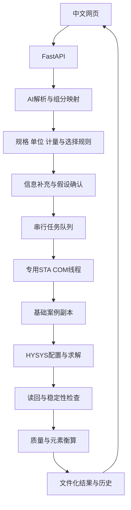
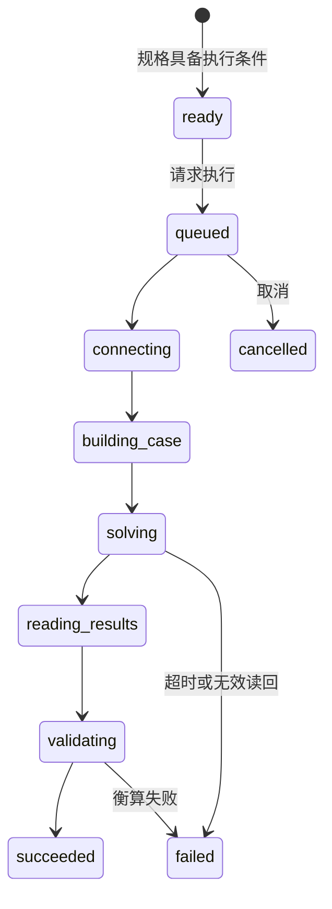

# 系统架构

[返回项目首页](../README.md)

## 职责分离

AI负责语言解释，确定性规则负责模型判断，HYSYS负责数值求解。任务规格、决策、事件与案例共用运行编号，使结果可追溯到原始需求和假设。

| 模块 | 职责 | 主要入口 |
|---|---|---|
| AI适配 | 调用、严格抽取、组分归一化、假设标记 | [parser.py](../app/ai/parser.py) |
| 领域规则 | 模型选择、规格、单位与反应计量 | [domain](../app/domain) |
| HYSYS适配 | COM生命周期、构建、求解与读回 | [v15_session.py](../app/hysys/v15_session.py) |
| 执行调度 | 队列、状态、异常与关闭处理 | [worker.py](../app/runs/worker.py) |
| 存储 | 元数据、事件、案例与结果 | [repository.py](../app/runs/repository.py) |
| 界面 | 输入、规格编辑、轮询、结果与下载 | [web](../app/web) |

## 反应器选择

| 已知条件 | 规则判断 | 当前执行支持 |
|---|---|---|
| 无完整动力学，已知转化率 | Conversion | 有 |
| 明确可逆反应，平衡数据可用 | Equilibrium | 有 |
| 高温复杂体系，候选产物及必要信息具备 | Gibbs | 仅判断 |
| 完整液相动力学与必要设备信息 | CSTR | 仅判断 |
| 完整气相动力学与必要设备信息 | PFR | 仅判断 |

显式指定模型仍须校验所需条件。动力学、聚合及复杂网络不能用给定转化率模型替代。

## 主要状态路径

连接、构建与读取阶段也可能失败。取消在安全边界处理，不代表立即中断HYSYS。重启后的未完成任务按恢复规则标记，不能自动认定成功。

## 执行边界

COM对象在专用STA线程中创建和使用，队列串行执行。操作基础案例副本，不直接修改基础案例；只关闭明确由应用拥有的会话。

进料有效后尝试控制设置；必要时精确匹配窗口和控件进行界面辅助，失败则提示人工处理。无论控制开关如何读回，都要求实际出口、转化率与衡算满足检查条件。

## 结果接受条件

- 变量存在且为有限、有效数值，拒绝未初始化值和负流量。
- 出口达到稳定读回条件；Conversion案例达到目标基准转化率。
- 根据实际流量独立校验质量与元素守恒，默认相对容差0.5%。
- 来源、案例路径与任务编号关联。

当前稳定性判据不是对V15原生设备收敛属性的全面封装。实机应核对设备状态。多温度工况分别保存案例，不能把不同工况的汇总热负荷当作一个工况解释。
